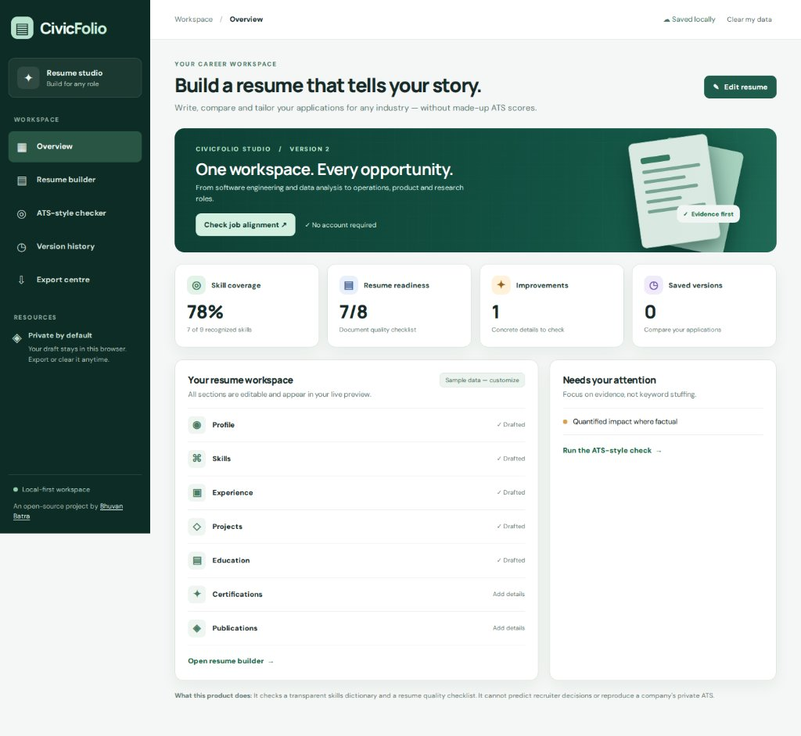
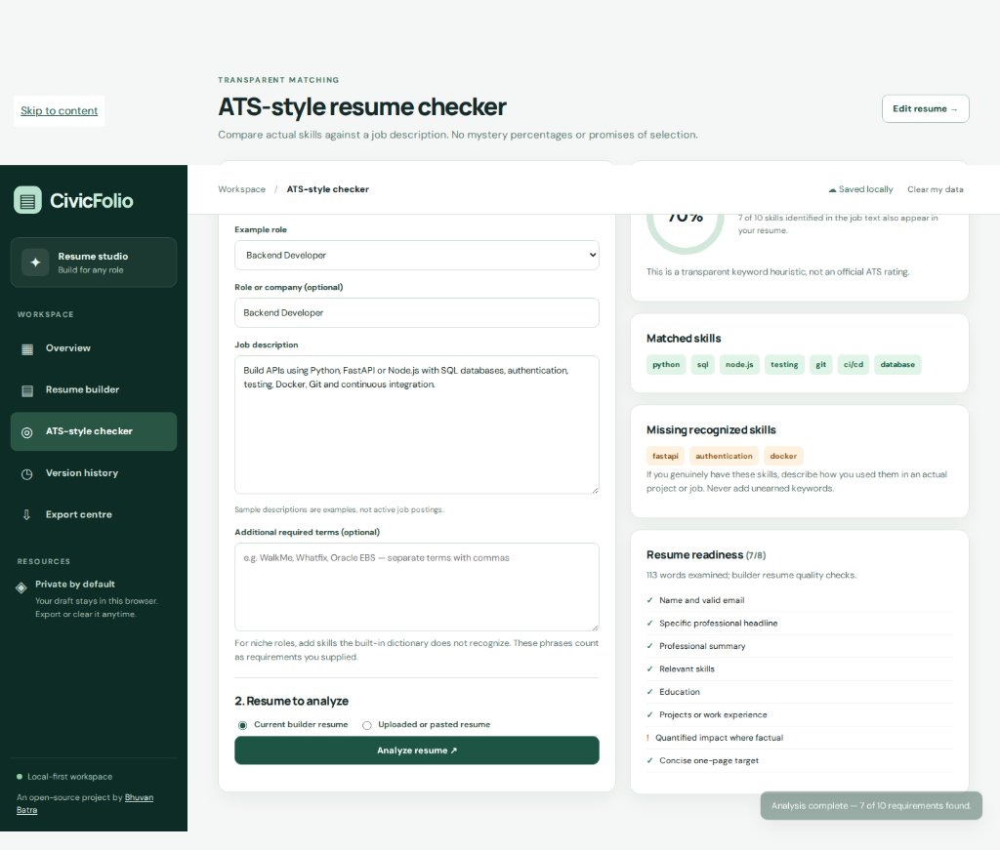

# CivicFolio — Resume Builder & ATS-Style Checker

A **general-purpose, local-first resume builder** with transparent job-description matching, version history and A4 PDF printing. Built by [Bhuvan Batra](https://github.com/HuMaN-OG).

**[Open the live CivicFolio app](https://human-og.github.io/CivicFolio/)** · [Source code](https://github.com/HuMaN-OG/CivicFolio) · [Automated browser-test evidence](https://github.com/HuMaN-OG/CivicFolio/actions/workflows/browser-smoke.yml)

  

**Important:** CivicFolio is not an ATS vendor, does not predict hiring decisions, and does not provide a proprietary “ATS pass score.” Skill coverage is an interpretable dictionary-based heuristic.

## Public-sector case study and project history

CivicFolio began as an NIC-focused portfolio and resume prototype. Its useful ideas—public-service role targeting, an evidence-backed project showcase, and an explainable skill comparison—are retained in the current general-purpose product. Read the [public-sector case study](docs/public-sector-case-study.md) for the original use case, a reproducible demonstration and the archived v1 commit. The default profile is deliberately fictional; no user's private resume data is embedded in the app.

## What problem does it solve?

Candidates need to tailor resumes for many roles, understand which job requirements they have actually demonstrated, track revisions, and produce readable documents. CivicFolio combines those workflows in one responsive application without requiring a login.

## Features

| Feature | Details |
| --- | --- |
| **Resume builder** | Editable name/contact, summary, skills, experience, projects, education, certifications and publications |
| **Live preview** | Single-column resume generated from entered data; user content is HTML-escaped and unsafe links are blocked |
| **Multi-role job checker** | Paste any job description or try example Software, Backend, Data, ML, Deployment, Product or Digital Services roles |
| **ATS-style skill matching** | Shows matched vs missing recognized competencies, using the transparent dictionary in [js/matcher.js](js/matcher.js) |
| **Imported resume analysis** | Check the editable resume, paste text, or import TXT, MD, PDF or DOCX files |
| **Readiness checklist** | Contact information, headline, summary, skills, education, experience, measurable evidence and length |
| **Version history** | Save labeled snapshots, compare changed sections, restore or remove earlier versions |
| **Data portability** | Export and import your workspace JSON |
| **A4 export** | Browser Print / Save as PDF; modern or classic ATS-friendly single-column resume layout |
| **Local-first privacy** | Browser localStorage; no CivicFolio account, database or server-side resume uploads |
| **Responsive UI** | Navigation for mobile, keyboard focus styles and semantic HTML |

  

The default “Alex Morgan” candidate is **fictional sample data**, not a real person’s resume. Replace it before using CivicFolio for an application.

## Running locally

1. Clone: https://github.com/HuMaN-OG/CivicFolio
2. Open the repository folder.
3. With Python 3 installed, run:

    python -m http.server 3000

4. Visit http://localhost:3000.

Node.js 20+ runs the zero-dependency tests:

    npm run verify

This runs browser JavaScript syntax checks and Node's built-in test runner.

## Typical workflow

1. **Build:** Open Resume builder, use the fictional sample or Start blank, and edit all relevant sections.
2. **Analyze:** Open ATS-style checker, paste a real job description and compare it against the current resume or another pasted/uploaded document.
3. **Improve:** Inspect matched and missing skills. Mention missing competencies **only if you can truthfully demonstrate them** through work or projects.
4. **Version:** Save a named snapshot, tailor for a different role, and compare the updated sections.
5. **Export:** Choose Modern or Classic; use Print / Save as PDF. Verify print page count and remove unnecessary text if it spills beyond one page. Export JSON as a backup.

## Architecture

- **index.html:** Dashboard, editor, checker, versions and export screens
- **css/style.css:** Responsive styles, live preview and A4 print layout
- **js/data.js:** Fictional sample profile and general job descriptions
- **js/matcher.js:** Defined skill aliases, document checks and comparison logic
- **js/render.js:** Safe HTML renderer for preview and printed resume
- **js/app.js:** Browser interactions, local persistence, file parsing and version history
- **tests/:** Deterministic checks for matching, validation, safety and section changes
- **.github/workflows/:** Test and GitHub Pages automation

No backend is necessary. The deployed application is static and can be hosted on GitHub Pages.

## Privacy, honesty and limitations

- Resume information and saved versions stay in the browser’s localStorage on the current device and origin; they are not synchronized to an account. **Clear my data** deletes that local workspace.
- The app does not transmit resume text to a CivicFolio API. For PDF/DOCX imports, it downloads parser JavaScript from a third-party CDN on demand. This requires a network connection and trust in those dependencies. TXT/MD and pasted text need no external parser.
- Image-only/scanned PDFs may have no extractable text. PDF and DOCX imports are for **checking**, not automatic reconstruction into the editor.
- Its curated skill dictionary is incomplete, and exact aliases can miss synonyms. **Missing** means "not recognized in this resume text," not "the candidate lacks the skill."
- There is no claim of recruiter approval probability, actual employer ATS equivalence, or guaranteed interview selection.
- LocalStorage is not encrypted; avoid storing personal details on a shared computer.
- Long resumes can print to multiple pages. Check the browser's print preview manually.
- **Never add an unearned skill or fabricated number just to increase coverage.**

## Deploying

GitHub Actions tests changes on pull requests. The repository's Pages workflow can publish main once the owner has enabled **Settings → Pages → Source: GitHub Actions**.

A green CI status verifies syntax and unit checks, not full browser/device compatibility. Manually test mobile layout, PDF page count, PDF/DOCX import, local data restoration and accessibility before claiming complete cross-browser coverage.

## How this helps my portfolio

**Resume-ready description:**

> Built CivicFolio, a responsive, privacy-first resume builder and ATS-style checker using HTML, CSS and JavaScript. Implemented editable resume sections, transparent job-description skill matching, import analysis, browser-based version control, accessible A4 print layouts, and automated regression tests.

**Owner:** [Bhuvan Batra](https://github.com/HuMaN-OG) · [LinkedIn](https://www.linkedin.com/in/bhuvan-batra-a75267220/)
