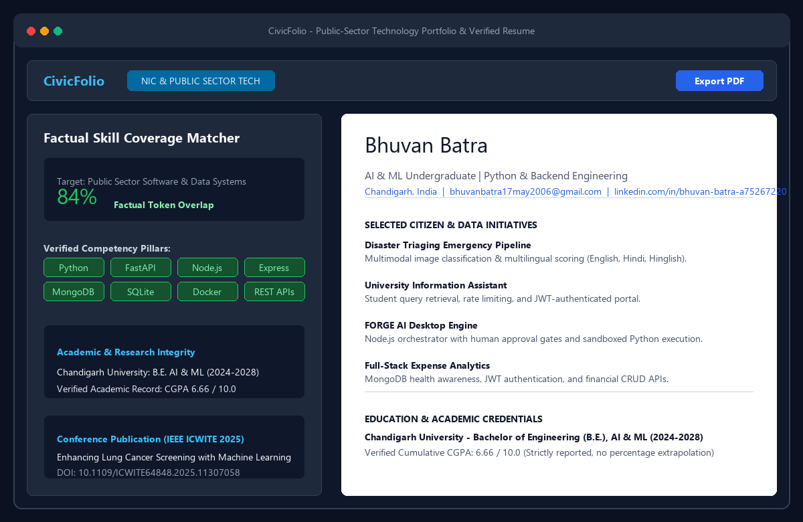

# 🏛️ CivicFolio

> An accessible resume and public-sector software portfolio application tailored for NIC-style digital governance, public data systems, and software engineering roles.



---

## 🎯 Purpose and Real Capabilities

CivicFolio is built specifically to address the needs of public-sector technical evaluations, e-governance technology roles, and software engineering internships:
- **Interactive Technical Portfolio**: Highlights citizen-facing systems (Disaster Triaging, University Chatbot, FORGE AI, Expense Tracker) and peer-reviewed research.
- **Truthful Skill Matching Engine**: Compares applicant skills against actual job requirements using semantic token overlap rather than opaque, fabricated ATS percentages.
- **Data Validation & Privacy**: Warns if required credentials or academic fields are missing. Restricts sensitive contact information (phone number) strictly to downloaded print media.
- **One-Page PDF Export**: Specialized `@media print` stylesheet ensures clean, accessible PDF generation directly via browser Print (`Ctrl + P`).
- **Academic & Research Integrity**: Reflects verified cumulative performance (**CGPA 6.66 / 10.0**, without fabricated percentage conversions) and links the official **IEEE ICWITE 2025** conference publication.

---

## 🛠️ Tech Stack

- **Frontend**: Vanilla HTML5 (semantic ARIA landmarks), CSS3 (CSS variables, responsive grid, `@media print`), JavaScript (ES6+).
- **Testing**: Built-in Node.js Test Runner (`node:test`, `node:assert/strict`).
- **CI / CD**: GitHub Actions automated pipeline.

---

## 🚀 Getting Started

### 1. Run Locally
```bash
# Serve using any standard static server (e.g. Node serve or Python)
npx serve -l 3000 .
# or
python -m http.server 3000
```
Open `http://localhost:3000` in your browser.

### 2. Run Automated Tests
```bash
npm test
```

---

## 📄 Public Resume Versions

Two role-specific, factual resumes are available as publicly viewable GitHub documents. These are designed to match the polished, one-page PDFs available from the resume owner.

- **[NIC — Software & e-Governance Resume](resumes/NIC_Resume.md)**
- **[SLB — Deployment Analyst Resume](resumes/SLB_Resume.md)**

> The public GitHub pages show the resume text; the submitted PDF version is formatted as exactly one A4 page. For a **direct public PDF link**, upload the matching PDF to Google Drive and enable “Anyone with the link → Viewer,” or enable GitHub Pages and publish the PDFs there. Do not imply academic eligibility based solely on the resume: check each employer's stated criteria.

---

## 🔗 Verified Profiles & Publications

- **LinkedIn**: [https://www.linkedin.com/in/bhuvan-batra-a75267220/](https://www.linkedin.com/in/bhuvan-batra-a75267220/)
- **GitHub**: [https://github.com/HuMaN-OG](https://github.com/HuMaN-OG)
- **IEEE Publication**: [DOI: 10.1109/ICWITE64848.2025.11307058](https://doi.org/10.1109/ICWITE64848.2025.11307058)

---

## 📝 License
MIT License.
